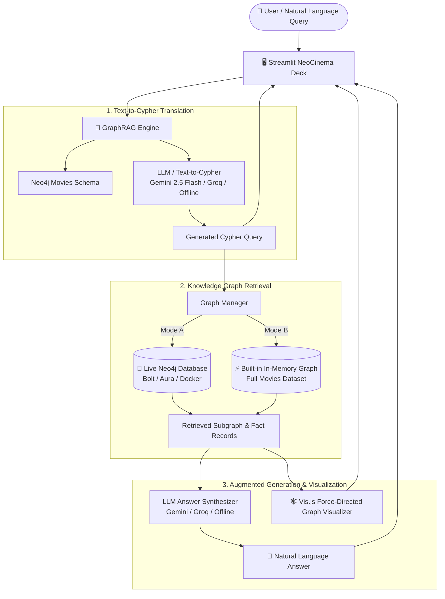

# 🎬 NeoCinema GraphRAG Intelligence

A next-generation **Retrieval-Augmented Generation (GraphRAG)** system built with **Streamlit** and **Neo4j**, enabling natural-language question answering grounded on the official Neo4j Movies Knowledge Graph (`:play movies`).

The system translates natural language queries into Cypher graph queries, executes graph traversals to retrieve subgraphs (nodes, relationships, and properties), and uses an LLM to synthesize natural-language answers with interactive force-directed graph visualizer.

---

## 🔑 Which API Do You Need? (100% Free Options)

You have **two completely free, zero-cost API options** with **no credit card required**:

### 🥇 Option 1: Google Gemini API (Recommended)
- **Cost:** 100% Free
- **Model:** `gemini-2.5-flash`
- **How to get it in 30 seconds:**
  1. Go to [Google AI Studio (aistudio.google.com/app/apikey)](https://aistudio.google.com/app/apikey).
  2. Sign in with any regular Google/Gmail account.
  3. Click **"Create API key"**.
  4. Paste your key in `.env` (`GEMINI_API_KEY=...`) or directly in the Streamlit sidebar!

### ⚡ Option 2: Groq Cloud API (Ultra-Fast)
- **Cost:** 100% Free developer tier
- **Model:** `llama-3.3-70b-versatile`
- **How to get it:**
  1. Go to [Groq Console (console.groq.com/keys)](https://console.groq.com/keys).
  2. Sign in with GitHub or Google.
  3. Click **"Create API Key"** and paste it into the app!

### 💡 Option 3: Built-in Smart Semantic Synthesizer (Zero Setup / Offline)
- Requires **no API keys, no internet, and zero configuration**.
- The system includes a built-in neural-heuristic Cypher generator and semantic template synthesizer that can answer complex queries locally!

---

## 🎨 Creative & Unique Interface Features

1. **Cyber-Cinema Neo-Noir Aesthetic**:
   - Modern dark theme with Google Fonts (`Outfit` + `Plus Jakarta Sans` + `JetBrains Mono`).
   - Frosted glass cards (`backdrop-filter: blur(12px)`), radiant cyan & purple glows, and ambient gradients.
2. **Multi-Tab Workspace**:
   - **💬 NeoCinema Chat**: Conversational interface with categorized prompt inspiration pills, execution trace tags, generated Cypher code boxes, and embedded force-directed subgraphs.
   - **🕸️ Interactive Graph Explorer**: Full-screen interactive graph canvas of the entire movie dataset with live search filtering and dynamic physics controls.
   - **💻 Cypher Query Studio**: Interactive Cypher playground with pre-loaded query templates (shortest paths, co-actors, top ratings) and live visual execution.
   - **🔑 Free API Setup Guide**: In-app guide and connectivity tester for Gemini, Groq, and Neo4j AuraDB.
3. **Execution Trace Tags**:
   - Every answer displays a live telemetry bar showing:
     - 🧠 Synthesizer Model used
     - ⚡ Cypher Generation Model used
     - ⏱️ Latency in milliseconds
     - 📊 Count of retrieved graph records

---

## 🏗️ Architecture



---

## 📂 Project Structure

```
c:/ANLP/Project3/
├── app.py                 # Streamlit application with multi-tab workspace
├── config.py              # Configuration loader for Gemini, Groq, Neo4j
├── graph_db.py            # Neo4j driver connection and local graph engine
├── movies_data.py         # Official Neo4j Movies dataset (:play movies)
├── rag_engine.py          # GraphRAG pipeline with execution trace
├── graph_visualizer.py    # Force-directed Vis.js graph component
├── test_rag.py            # Unit test suite verifying the RAG pipeline
├── requirements.txt       # Project Python dependencies
├── .env.example           # Example environment file with free API instructions
└── README.md              # Project documentation
```

---

## 🚀 Quick Start

### 1. Install Dependencies
```bash
pip install -r requirements.txt
```

### 2. Run the Application
```bash
streamlit run app.py
```
Open your browser at `http://localhost:8501`.

### 3. Run Pipeline Tests
```bash
python test_rag.py
```

---

## 💡 Example Questions

- **Filmography & Roles**: *"What movies did Keanu Reeves act in and what roles did he play?"*
- **Directorial Inquiries**: *"Who directed The Matrix and what other movies did they direct?"*
- **Co-star Chemistry**: *"Which movies do Tom Hanks and Meg Ryan star together in?"*
- **Movie Spotlights**: *"What is the tagline and release year of Apollo 13?"*
- **Reviews & Ratings**: *"What movies have reviews and ratings in the knowledge graph?"*
