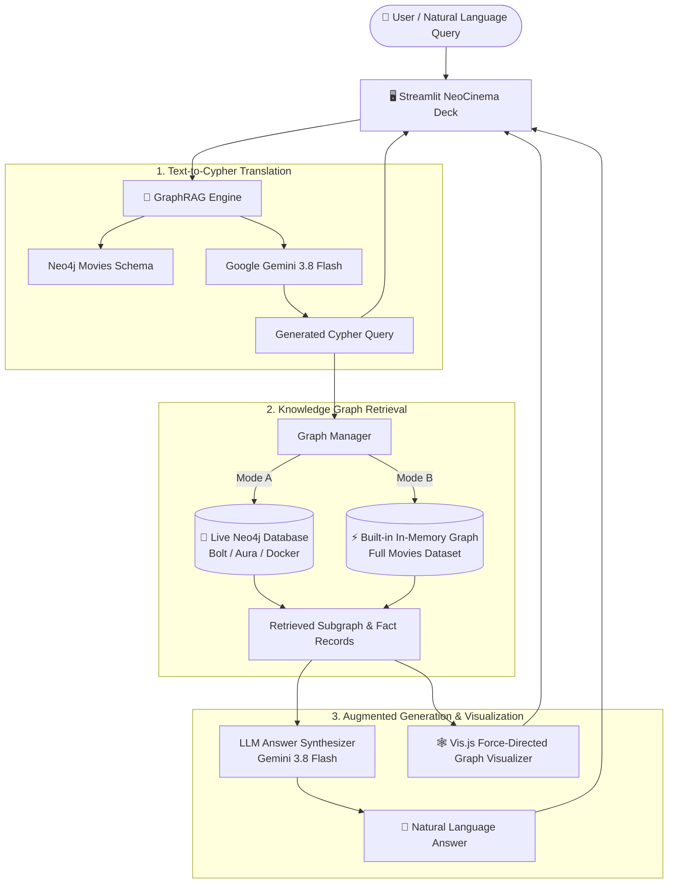

# 🎬 NeoCinema GraphRAG Intelligence

A next-generation **Graph Retrieval-Augmented Generation (GraphRAG)** system built with **Streamlit**, **Google Gemini**, and the official **Neo4j Movies Dataset** (`:play movies`).

The system translates natural-language movie questions into **Cypher graph queries**, traverses the connected knowledge graph (actors, directors, movies, roles, release dates), and synthesizes rich factual answers grounded strictly in graph knowledge.

---

## 📸 Interface Previews (Cyber-Cinema Dark Theme)

| 1. Main Deck & Inspiration Queries | 2. Synthesized Answer & Telemetry |
| :---: | :---: |
|  |  |

| 3. Generated Cypher & Graph Records | 4. Interactive Force-Directed Subgraph |
| :---: | :---: |
|  |  |

---

## ✨ Features

- **⚡ Graph-Grounded RAG**: Automatically turns user queries into Cypher graph queries and fetches multi-hop relationships.
- **🧠 Google Gemini Integration**: Uses `gemini-3.8-flash` via `.env` configuration for Cypher translation and natural-language synthesis.
- **🔌 Dual-Engine Architecture**:
  - **Built-in In-Memory Knowledge Graph**: Instant zero-setup offline operation preloaded with 22 movies, 92 people, and 150 relationships.
  - **Live Neo4j Instance**: Seamless connection to Neo4j Desktop, Docker, or Neo4j AuraDB via Bolt protocol.
- **🕸️ Interactive Subgraph Visualization**: Dynamic physics-driven Vis.js force-directed network graph rendered directly inside the chat.
- **📊 Live Execution Telemetry**: Transparent execution tags showing latency (ms), retrieved records count, and models used.
- **🎨 Pure Cyber-Cinema Dark Theme**: Polished dark aesthetic with glowing accents and clear contrast.

---

## 🏗️ Architecture



---

## 📂 Project Structure

```
.
├── .env.example              # Template for environment configuration
├── .gitignore                # Git ignore rules (ignoring .env and logs)
├── .streamlit/
│   └── config.toml           # Streamlit dark theme settings
├── README.md                 # Project documentation and visual tour
├── app.py                    # Streamlit web application & UI
├── config.py                 # Configuration loader
├── graph_db.py               # Neo4j driver and built-in graph engine
├── graph_visualizer.py       # Vis.js network graph builder
├── movies_data.py            # Official Neo4j Movies dataset
├── rag_engine.py             # GraphRAG pipeline & execution trace
├── requirements.txt          # Python dependencies
└── screenshots/              # High-contrast application screenshots
    ├── fig_7_3_1_input_screen.png
    ├── fig_7_3_2_answer_result.png
    ├── fig_7_3_3_cypher_records.png
    └── fig_7_3_4_subgraph_visualizer.png
```

---

## 🚀 Quick Start

### 1. Clone & Install Dependencies
```bash
git clone https://github.com/Manishankar-614/Neo4j_Movies.git
cd Neo4j_Movies
pip install -r requirements.txt
```

### 2. Configure Environment Variables
Copy `.env.example` to `.env` and add your Gemini API key:
```bash
cp .env.example .env
```
In `.env`:
```env
GEMINI_API_KEY=your_actual_gemini_api_key_here
```

### 3. Run the Application
```bash
streamlit run app.py
```
Open your browser at `http://localhost:8501`.

---

## 💡 Example Questions

- **Filmography & Roles**: *"What movies did Keanu Reeves act in and what roles did he play?"*
- **Directorial Inquiries**: *"Who directed The Matrix and what other movies did they direct?"*
- **Co-star Chemistry**: *"Which movies do Tom Hanks and Meg Ryan star together in?"*
- **Movie Spotlights**: *"What is the tagline and release year of Apollo 13?"*
- **Reviews & Ratings**: *"What movies have reviews and ratings in the knowledge graph?"*
