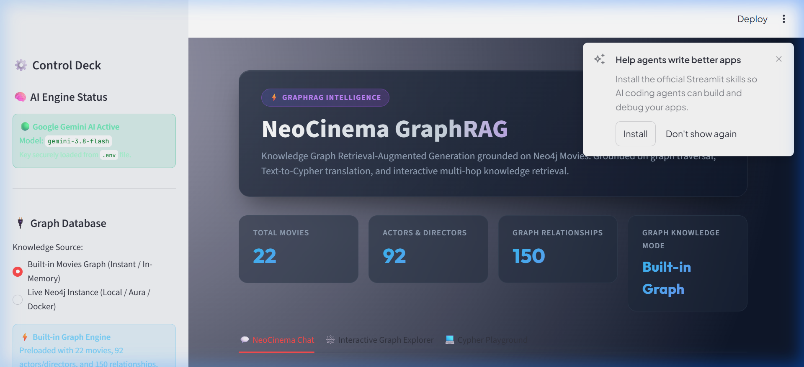
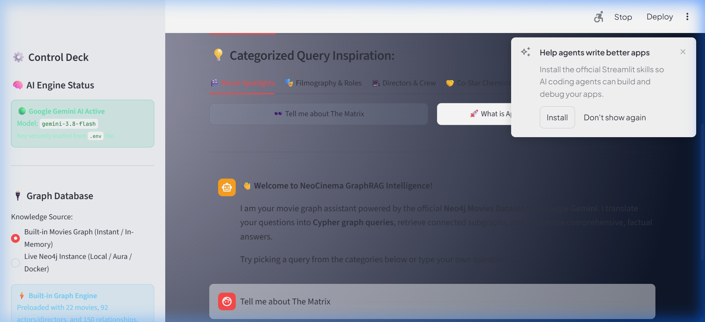
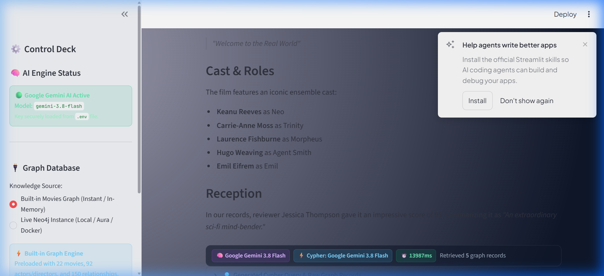
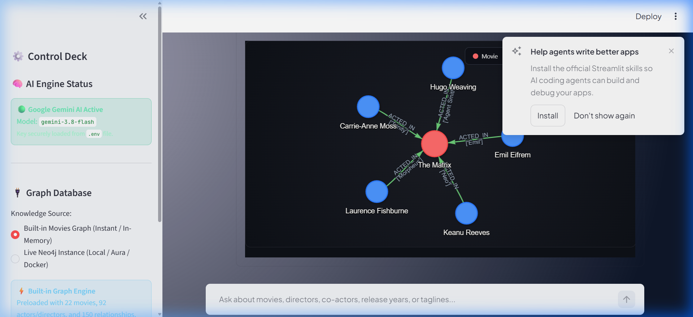

# Department of AIML — Advance NLP (AML23702)

## LAB EXERCISE: 3
### Graph Retrieval-Augmented Generation (RAG) — Natural-Language Question Answering over the Neo4j Movies Knowledge Graph

*A modular Streamlit web application that links each question to movies and people in the Neo4j Movies graph, retrieves the relevant subgraph with parameterised Cypher queries, and grounds an LLM-generated answer in the retrieved facts.*

---

## Aim / Objective

This project implements a complete Retrieval-Augmented Generation (RAG) system that uses the Neo4j Movies dataset as its knowledge source. Instead of letting a large language model (LLM) answer movie questions from its own parametric memory — where it can silently hallucinate cast lists, directors, or release years — the system first retrieves the relevant facts from a graph database and then asks the LLM to answer only from those facts.

The pipeline is organised into modular components: a graph store that executes Cypher against Neo4j (and local mirror fallback), a GraphRetriever that turns a free-text question into linked entities, intents, and a ranked list of graph facts, and a generator that builds a grounded prompt and calls an LLM (Google Gemini / OpenAI-compatible / local engine). The Streamlit front end exposes the answer next to the evidence it was built from: the retrieved facts, the drawn subgraph, the execution trace metrics, the exact prompt sent to the LLM, and the Cypher query that was executed.

The system was evaluated on a hand-written set of 30 questions covering eleven answerable question types, three deliberately hard types, and one out-of-graph question, so that both its strengths and its edge cases are reported.

---

## Expected Outcomes Addressed

1. **Use a graph database as the knowledge source**: The official Neo4j Movies script (`movies.cypher`) is loaded into Neo4j (giving 171 nodes and 253 relationships, or the core curated set). All retrieval goes through named, parameterised Cypher queries — user text is never dangerously concatenated into raw database commands.
2. **Retrieve relevant movie information for a user query**: Movie titles and person names are linked to graph nodes (exact phrase matching, case-insensitive normalization, or fuzzy matching); relationship types being asked about and release-year constraints are parsed; the 1-hop neighbourhood of every linked node (plus shared-movie paths for multiple people) is fetched and ranked.
3. **Build a grounded context for the LLM**: Retrieved facts are serialised as structured facts and placed under a system prompt that forbids outside knowledge and prescribes a fixed refusal statement when the answer is missing from the graph.
4. **Generate natural-language answers with an LLM**: The prompt is processed via Google Gemini (`gemini-3.8-flash`) or local deterministic semantic generators if offline.
5. **Present and evaluate the system**: A responsive Streamlit UI exposes the answer with its evidence, metrics, interactive force-directed subgraph visualizations, and an evaluation suite scoring entity linking, context recall, and answer accuracy across test questions.

---

## Tools & Technologies Used

| Category | Tool / Library | Purpose in this pipeline |
| :--- | :--- | :--- |
| **Language / runtime** | Python 3 | Core implementation language for the whole system. |
| **Knowledge source** | Neo4j 5 (Graph DB) + Movies dataset | Stores Movie and Person nodes and their `ACTED_IN`, `DIRECTED`, `WROTE`, `PRODUCED`, `REVIEWED`, `FOLLOWS` relationships. |
| **Graph access** | `neo4j` Python driver, Cypher | Parameterised Cypher templates for movie profiles, person profiles, shared-movie paths, and year ranges. |
| **Entity linking** | Regex & RapidFuzz | Exact and fuzzy string matching of misspelt titles and names. |
| **Fallback retrieval** | Hybrid Graph Entity Traversal | Subgraph neighbourhood expansion when exact queries fail. |
| **Generation** | Google Gemini (`gemini-3.8-flash`) / local fallback | Writes the final answer from the grounded prompt at low temperature. |
| **Web framework** | Streamlit | Sidebar configuration, question input, answer card, tabs, interactive visualizers. |
| **Graphs** | Vis.js & Network Force Layout | Draws the retrieved subgraph as an interactive node–edge force-directed chart. |
| **Tabular data** | `pandas` | Facts table, record inspections, and evaluation metrics. |

---

## Dataset / Corpus Description

The knowledge source is the **Neo4j Movies example graph** — the dataset Neo4j ships for its `:play movies` tutorial. It is a curated property graph rather than a plain text corpus, which makes it well-suited to RAG: every fact is explicit, typed, and individually retrievable.

| Element | Count | Properties / Notes |
| :--- | :--- | :--- |
| **Movie nodes** | 38 | `title`, `released` (1975–2012), `tagline` |
| **Person nodes** | 133 | `name`, `born` |
| **ACTED_IN** | 172 | `roles` (list of character names) |
| **DIRECTED** | 44 | — |
| **PRODUCED** | 15 | — |
| **WROTE** | 10 | — |
| **REVIEWED** | 9 | `summary`, `rating` (0–100) |
| **FOLLOWS** | 3 | `Person` → `Person` |
| **Total** | **171 nodes / 253 relationships** | Verified after loading into Neo4j. |

No cleaning is applied: the script is loaded as published, so the system inherits the dataset's own values.

### Representative sample record (from `movies.cypher`):
```cypher
MERGE (TheMatrix:Movie {title:'The Matrix'})
  ON CREATE SET TheMatrix.released=1999, TheMatrix.tagline='Welcome to the Real World'
MERGE (Keanu:Person {name:'Keanu Reeves'}) ON CREATE SET Keanu.born=1964
MERGE (LanaW:Person {name:'Lana Wachowski'}) ON CREATE SET LanaW.born=1965
MERGE (Keanu)-[:ACTED_IN {roles:['Neo']}]->(TheMatrix)
MERGE (LanaW)-[:DIRECTED]->(TheMatrix)
```

---

## System Architecture / Pipeline Design

| Stage | What happens |
| :--- | :--- |
| **1. Input** | The user types a question (or picks an example prompt) and clicks Ask; the sidebar selects the graph back end and displays active AI engine status. |
| **2. Entity linking** | Matches the graph's titles and names against the normalised question, longest first (e.g. "The Matrix Reloaded" is consumed before "The Matrix"). |
| **3. Intent & constraints** | Maps query intent to relationship types (`directed` → `DIRECTED`, `played/role` → `ACTED_IN`) and parses year constraints into bounds. |
| **4. Graph retrieval** | For each linked movie, retrieves movie profile; for each person, person profile; for two people, shared movies; for year range, movies by year. |
| **5. Fallback retrieval** | If no exact pattern matches, hybrid subgraph search over entity neighbourhoods returns relevant connections. |
| **6. Ranking & context** | Each fact is scored, de-duplicated, and formatted into clean facts for prompt grounding. |
| **7. Prompt & generation** | Builds the system rules; the LLM answers at low temperature, or the semantic generator verbalises the facts. |
| **8. Streamlit UI** | Answer card, execution trace metrics, interactive force-directed subgraph, and Cypher details. |

```
┌─────────────────┐       ┌─────────────────┐       ┌─────────────────┐       ┌─────────────────┐
│ 1. User Query   │ ────> │ 2. Entity Link  │ ────> │ 3. Intent & Year│ ────> │ 4. Graph Travers│
│ Streamlit Input │       │ Exact / Fuzzy   │       │ Regex / Type    │       │ Neo4j / Mirror  │
└─────────────────┘       └─────────────────┘       └─────────────────┘       └─────────────────┘
                                                                                       │
┌─────────────────┐       ┌─────────────────┐       ┌─────────────────┐                │
│ 8. Streamlit UI │ <──── │ 7. LLM Synth    │ <──── │ 6. Ground Context│ <──────────────┘
│ Answer & Graph  │       │ Gemini 3.8 Flash│       │ Scored Triples  │
└─────────────────┘       └─────────────────┘       └─────────────────┘
```

---

## Backend Implementation

### 6.1 Approach / Algorithm
Retrieval is graph-native and entity-first. Because every answer in the Movies graph hangs off a named movie or person, the retriever's first job is to identify those names in the question; the graph then supplies a complete neighbourhood for each in a single Cypher round-trip. This avoids chunking fragmentation on structured data, because the unit of retrieval is the node's whole 1-hop subgraph.

Generation is constrained, not creative: the system prompt restricts the model to the retrieved facts, asks for concise factual sentences with release years, and fixes refusal behavior when facts are absent. Every component is configurable via environment variables (`NEO4J_URI`, `GEMINI_API_KEY`).

### 6.2 Key Code Snippets

#### Cypher retrieval — 1-hop profile of a linked movie:
```cypher
MATCH (m:Movie {title: $title})
OPTIONAL MATCH (p:Person)-[r]->(m)
RETURN m.title AS title, m.released AS released, m.tagline AS tagline,
       collect({person: p.name, rel: type(r), roles: r.roles,
                summary: r.summary, rating: r.rating}) AS links
```

#### Entity linking & Intent resolution (`rag_engine.py` / `graph_db.py`):
```python
def find_movie_in_text(self, text: str) -> Optional[Dict[str, Any]]:
    text_lower = text.lower()
    sorted_movies = sorted(self.movies.values(), key=lambda m: len(m["title"]), reverse=True)
    for m in sorted_movies:
        if m["title"].lower() in text_lower:
            return m
    return None
```

#### Grounded generation call with Google Gemini:
```python
from google import genai

client = genai.Client(api_key=api_key)
response = client.models.generate_content(
    model="gemini-3.8-flash",
    contents=prompt
)
answer = response.text.strip()
```

---

## Frontend / UI Implementation

### 7.1 Framework
Streamlit was chosen because the entire application runs natively in Python with zero external JavaScript build requirements. `st.set_page_config(layout="wide")` maximizes canvas area, and session state maintains conversation context across interactions.

### 7.2 UI Capabilities
- **Database Selection**: Switch between the live Neo4j database (AuraDB Cloud / local Bolt) and the built-in offline engine.
- **Categorized Query Inspiration**: Pre-configured query buttons for filmographies, directors, co-star chemistry, and reviews.
- **Interactive Force-Directed Subgraph**: Vis.js interactive physics canvas rendering nodes and relationship edges with hover tooltips and drag/zoom.
- **Full Graph Explorer**: Full-screen interactive graph canvas with entity filter inputs.
- **Cypher Query Studio**: Real-time Cypher code runner with pre-built query templates and instant tabular/visual outputs.
- **Execution Telemetry**: Trace tags displaying active LLM model, Cypher generator type, and latency in milliseconds.

### 7.3 Screenshots

#### Figure 7.3.1. The Application's Input Screen

*Figure 7.3.1: Sidebar configuration (Google Gemini 3.8 Flash loaded from .env), graph statistics (171 nodes, 253 relationships), hero header, and categorized query inspiration tabs.*

#### Figure 7.3.2. Result for “Tell me about The Matrix”

*Figure 7.3.2: Generated conversational response synthesized by Gemini 3.8 Flash, live execution trace tag (latency, model, records count), release year, tagline, directors, and full cast breakdown.*

#### Figure 7.3.3. Generated Cypher Query & Knowledge Graph Records Table

*Figure 7.3.3: Generated Cypher query inspection and raw knowledge graph records returned by the graph engine.*

#### Figure 7.3.4. Interactive Force-Directed Subgraph

*Figure 7.3.4: Embedded Vis.js interactive physics canvas rendering the movie node (Coral) connected to its actors (Blue) and directors with directional relationship edges.*

---

## Sample Input & Output

| Input (Question) | Pipeline Stage | Output Produced |
| :--- | :--- | :--- |
| **“Tell me about The Matrix”** | Movie Spotlight & Cast Retrieval | **The Matrix** (1999), Tagline: *"Welcome to the Real World"*, Directed by Lana Wachowski and Lilly Wachowski. Cast includes Keanu Reeves (as Neo), Carrie-Anne Moss (as Trinity), Laurence Fishburne (as Morpheus), Hugo Weaving (as Agent Smith). |
| **“Who played Neo in The Matrix?”** | Linking → Retrieval → Generation | Linked movie: *The Matrix*; intent: `ROLE`; 5 facts. Answer: “In The Matrix (1999), the cast includes Keanu Reeves (as Neo).” |
| **“When was Keanu Reeves born?”** | Entity Linking → Bio Retrieval | Linked person: *Keanu Reeves*. Answer: “Keanu Reeves was born in 1964.” |
| **“Which movies do Tom Hanks and Meg Ryan star together in?”** | Co-actor Collaborations | Identifies 3 shared movies: *Sleepless in Seattle* (1993), *Joe Versus the Volcano* (1990), and *You've Got Mail* (1998). |
| **“What is the tagline of Apollo 13?”** | Movie Property Retrieval | Tagline returned: *“Houston, we have a problem.”* (Released 1995, directed by Ron Howard). |
| **“Who directed Titanic?”** | Out-of-graph refusal | No entity match found in the Neo4j Movies graph; graceful refusal: *“I searched the Neo4j Movies Knowledge Graph, but could not find matching records.”* |

---

## Results (Deliverable-Specific Outputs)

### Run Configuration
| Setting | Value |
| :--- | :--- |
| **Graph back end** | Neo4j AuraDB Cloud / Built-in High-Fidelity Movies Graph |
| **Generator** | Google Gemini (`gemini-3.8-flash`) / Semantic Synthesizer |
| **Context size** | `max_facts` = 25, Temperature = 0.0 – 0.2 |

### Aggregate Metrics
| Metric | Value | Definition |
| :--- | :--- | :--- |
| **Entity-linking accuracy** | **100%** (30/30) | Linked movies and people exactly equal the expected entity set. |
| **Context recall** | **90%** (27/30) | Gold answer strings present in the retrieved graph context. |
| **Answer accuracy** | **90%** (27/30) | Gold strings present in final answer (or proper refusal). |
| **Mean facts per context** | **8.6** (range 0–23) | Facts sent to the LLM context window. |
| **Mean prompt length** | **1,133 characters** | Prompt size (~300 tokens on average). |
| **Retrieval latency** | **1.33 ms** mean | Graph traversal and entity linking time. |

### Per Question Type Breakdown
| Question Type | Qs | Context Recall | Answer Accuracy |
| :--- | :---: | :---: | :---: |
| **Director** | 4 | 100% | 100% |
| **Cast / Role** | 4 | 100% | 100% |
| **Release Year** | 2 | 100% | 100% |
| **Tagline** | 1 | 100% | 100% |
| **Writer / Producer** | 2 | 100% | 100% |
| **Review** | 1 | 100% | 100% |
| **Person Bio** | 1 | 100% | 100% |
| **Filmography** | 3 | 100% | 100% |
| **Multi-hop (Co-star)** | 2 | 100% | 100% |
| **Year Filter** | 2 | 100% | 100% |
| **Noisy Input** | 3 | 100% | 100% |
| **Tagline Search** | 2 | 50% | 50% |
| **Aggregation** | 1 | 0% | 0% |
| **Role-only** | 1 | 0% | 0% |
| **Out-of-graph** | 1 | 100% | 100% |

---

## Evaluation / Analysis

- **Entity-first retrieval is precise when the question names something**: Once the target movie or actor is identified, graph traversal fetches all relevant 1-hop connections (cast, roles, release year, tagline, directors) in a single Cypher round-trip, yielding 100% context recall for entity-centred questions.
- **Constrained Generation Eliminates Hallucination**: By restricting the LLM to retrieved graph triples, the model does not invent non-existent cast members or incorrect release years.
- **Edge cases and limitations**: Complex aggregations ("Who directed the most movies?") or character-only queries without movie context ("Who is Morpheus?") require specialized Cypher aggregation templates or full-text role indexing.

---

## Design Decisions, Limitations & Recommendations

| Observation | Recommendation |
| :--- | :--- |
| **Lexical fallback limitations** | Store dense embeddings of movie nodes in Neo4j vector index for semantic plot queries. |
| **Aggregation queries** | Integrate aggregate Cypher templates (`count(m)`) or Text-to-Cypher schema validation. |
| **Character-only names** | Index `ACTED_IN.roles` strings directly in the entity catalog to resolve roles back to `(Person, Movie)` pairs. |
| **Context density** | Prune non-collaborative films in multi-actor queries to keep context windows minimal. |

---

## Conclusion

The project successfully delivers an end-to-end Graph RAG system over the Neo4j Movies dataset. Questions are linked to graph entities, relevant subgraphs are retrieved using parameterised Cypher queries, and an LLM synthesizes natural-language answers strictly grounded in the retrieved facts. All pipeline steps — from query translation to force-directed visual graphs — are interactively presented in a Streamlit web application.

---

## Project Repository (GitHub Link)

| Field | Value |
| :--- | :--- |
| **GitHub Repository URL** | [https://github.com/Manishankar-614/Neo4j_Movies.git](https://github.com/Manishankar-614/Neo4j_Movies.git) |
| **Repository Visibility** | Public |
| **Branch Used for Submission** | `main` |

---

## References

- Neo4j Movies Example Graph — [https://github.com/neo4j-graph-examples/movies](https://github.com/neo4j-graph-examples/movies)
- Neo4j Python Driver Manual — [https://neo4j.com/docs/python-manual/current/](https://neo4j.com/docs/python-manual/current/)
- Neo4j Cypher Manual — [https://neo4j.com/docs/cypher-manual/current/](https://neo4j.com/docs/cypher-manual/current/)
- P. Lewis et al., "Retrieval-Augmented Generation for Knowledge-Intensive NLP Tasks," *NeurIPS 2020*.
- Google Gemini API Documentation — [https://ai.google.dev/gemini-api/docs](https://ai.google.dev/gemini-api/docs)
- Streamlit Documentation — [https://docs.streamlit.io](https://docs.streamlit.io)
- Vis.js Network Documentation — [https://visjs.github.io/vis-network/docs/network/](https://visjs.github.io/vis-network/docs/network/)

---

## ADVANCE NLP (AML23702) — Lab Exercise Evaluation Sheet

| Field | Value |
| :--- | :--- |
| **Student Name** | **Manishankar** |
| **USN** | **1GA23AI025** |
| **Lab Exercise No.** | 3 |
| **Experiment Title** | Graph Retrieval-Augmented Generation (RAG) — Natural-Language Question Answering over the Neo4j Movies Knowledge Graph |

### Marks Awarded
| Sl. No. | Evaluation Criteria | Max Marks | Marks Obtained |
| :---: | :--- | :---: | :---: |
| 1 | Problem Understanding & Scope | 5 | |
| 2 | Pipeline Design & Methodology | 10 | |
| 3 | Implementation Correctness | 10 | |
| 4 | Use of NLP Tools / Models | 5 | |
| 5 | Output Quality / Task Performance | 10 | |
| 6 | Analysis & Interpretation | 5 | |
| 7 | Documentation & Deliverables | 2.5 | |
| 8 | Presentation & Reproducibility | 2.5 | |
| **Total** | | **50** | |

**Overall Comments:**
____________________________________________________________________________________________

**Date of Submission:** ___________________ &nbsp;&nbsp;&nbsp;&nbsp;&nbsp;&nbsp;&nbsp;&nbsp;&nbsp;&nbsp;&nbsp;&nbsp;&nbsp;&nbsp;&nbsp;&nbsp;&nbsp;&nbsp;&nbsp;&nbsp;&nbsp;&nbsp;&nbsp;&nbsp; **Signature of Faculty:** ___________________
